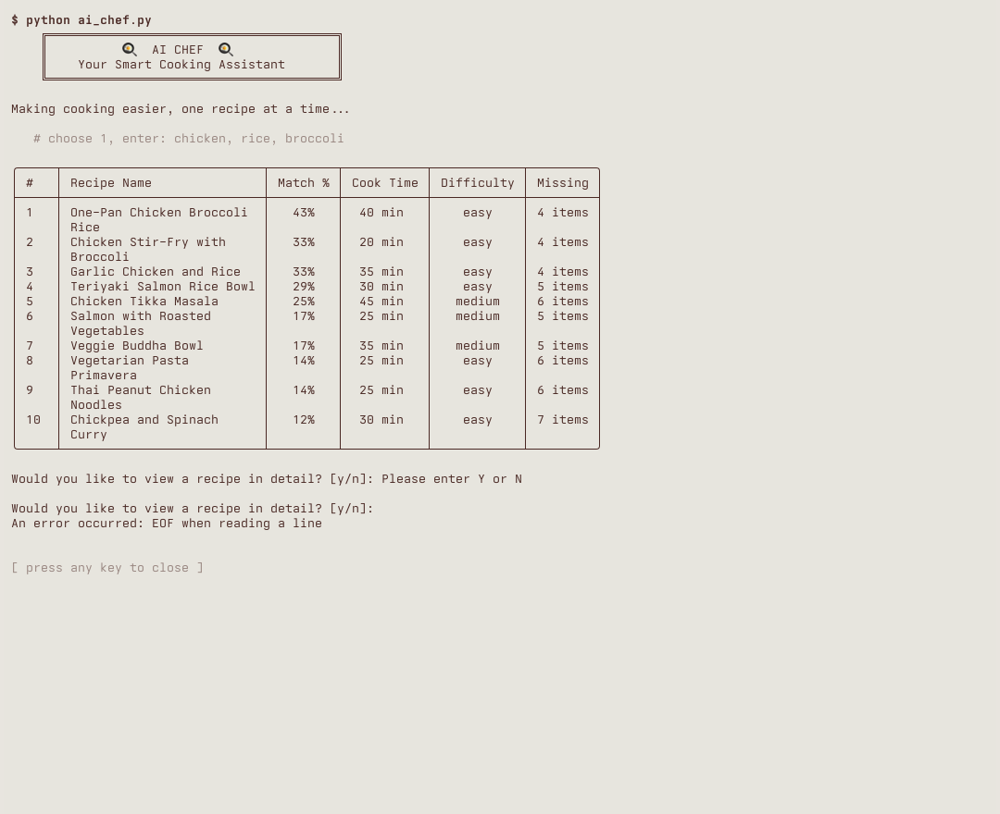

# Ai-Chef

[](https://github.com/IzonIcy/Ai-Chef/actions/workflows/ci.yml)
[](LICENSE)
[](pyproject.toml)

Ai-Chef is a terminal app for the cook standing in front of three ingredients with no plan: type what you have and it shows the recipes you can make right now, what each one is still missing, and a week of meals with a grocery list.

```bash
git clone https://github.com/IzonIcy/Ai-Chef.git && cd Ai-Chef && pip install -e . && python ai_chef.py
```



That table is option 1 on the non-AI path. The finder, search, pantry, planner, exports, scaling, and gamification all run from local files, with no key and no network.

## What it does

- Finds recipes from the ingredients you type in, and names what each one is still missing.
- Searches by name, cuisine, or ingredient across 19 built-in recipes plus your own.
- Filters by cook time, difficulty, dietary need, and cuisine.
- Plans a week of meals, then generates a grocery list from it and exports to CSV or Markdown.
- Tracks pantry stock with quantities and expiry dates, and ranks recipes by what is about to go bad.
- Keeps cooking streaks, achievements, and weekly challenges.
- Scales a recipe up or down, quantities included.
- Generates a custom recipe from a description, gives cooking tips, and suggests substitutions when an OpenAI key is set.

## How it compares

ChatGPT will answer almost anything you ask it, including a substitution you did not know you needed, and a recipe app has more recipes with photos than 19. Both are better than Ai-Chef at browsing and at cooking something new. What neither does is track your pantry with expiry dates, turn a week of meals into a grocery list you can export, or run with no network and no API key. Ai-Chef trades catalog size and polish for those three things, and it needs a terminal.

## What it does not do yet

- Ingredient matching is exact. Recipes store bare names like `chicken`, so typing `chicken breast` finds nothing, even though `chicken` is in the pantry. The finder compares strings, not food.
- The three AI features need `OPENAI_API_KEY`. Without it, recipe generation, cooking tips, and substitutions say so and return to the menu instead of failing mid-run.
- There is no web or mobile version. Every screen is a Rich prompt in a terminal.
- A grocery list exports to `.csv` and `.md` files in the data directory. There is no calendar sync and no shopping app integration.
- One local user. All state is JSON files in a single data directory, with no accounts and no sync between machines.
- The built-in library is 19 recipes, and a recipe you add yourself is typed in field by field through the menu.

## Running it

Requires Python 3.12 or newer. CI runs 3.13.

```bash
git clone https://github.com/IzonIcy/Ai-Chef.git
cd Ai-Chef
python -m venv .venv && source .venv/bin/activate
pip install -e .
python ai_chef.py
```

`mise install` sets up the pinned toolchain if you use [mise](https://mise.jdx.dev).

### Optional AI features

Every feature works without an API key. The recipe finder, meal planner, grocery export, scaling, and gamification are entirely local. The three AI-backed features (custom recipe generation, cooking tips, and ingredient substitutions) tell you they need a key and return to the menu, rather than failing somewhere in the middle. That is deliberate, so the app is useful without paying for anything.

To enable them, copy the example env file and fill in your key:

```bash
cp .env.example .env
```

```bash
OPENAI_API_KEY=sk-your-key-here
```

## Docker

```bash
docker build -t ai-chef .
docker run -it ai-chef
```

Pass the key in with `-e OPENAI_API_KEY=sk-...` if you want the AI path. Your recipes, plans, and pantry are written to the data directory inside the container, so mount a volume to `/home/chef/.local/share/ai-chef` to keep them.

## How it is built

Seven modules, flat and deliberately shallow. No framework, no ORM.

| Module            | Responsibility                                                              |
| ----------------- | --------------------------------------------------------------------------- |
| `ai_chef.py`      | Entry point. Rich TUI, menu dispatch, user prompts.                         |
| `ai_generator.py` | OpenAI calls + response parsing (JSON, with a text fallback).               |
| `recipes.py`      | Recipe data model, ingredient matching, text search, portion scaling.       |
| `meal_planner.py` | Weekly plans, grocery list generation, CSV/Markdown export, pantry, saved.  |
| `gamification.py` | Streaks, achievements, weekly challenges.                                   |
| `json_store.py`   | Atomic JSON read/write. All persistence funnels through here.               |
| `data_dir.py`     | Resolves the per-user data directory.                                       |

Python 3.12+, the OpenAI SDK, and Rich for the terminal UI. Built-in recipes live in code. Your own recipes, plans, pantry, and streaks live in `~/.local/share/ai-chef`, or under `$XDG_DATA_HOME/ai-chef` when that is set, or wherever `AI_CHEF_DATA_DIR` points. SQLite felt like overkill for a JSON file you can edit by hand, so `json_store` writes to a temp file and renames, and a crash mid-write cannot corrupt state.

Two conventions hold the rest together. The AI path is optional, and a refactor that breaks the non-AI path is a regression. Model output is untrusted, so `ai_generator` falls back to line-prefix parsing and both paths normalise through the same function.

## Development

`pyproject.toml` is the single source of truth for dependencies. There is deliberately no `requirements.txt`, because a second copy drifts out of sync with CI.

Run the same gates CI runs with:

```bash
pip install -e ".[dev]"
mise run check
```

`mise run check` runs `ruff check`, `ruff format --check`, `mypy`, and `python -m pytest`. `mise run fix` runs `ruff check --fix` and `ruff format`. Individually:

```bash
ruff check .
ruff format --check .
mypy
python -m pytest
```

`mypy` is scoped to the project modules by an explicit `files` list in `pyproject.toml`. If you add a module, add it to `[tool.mypy] files` and `[tool.setuptools] py-modules`, plus the `COPY` list in the `Dockerfile`.

See [CONTRIBUTING.md](CONTRIBUTING.md) for the conventions a change should follow, and [AGENTS.md](AGENTS.md) for how the modules fit together.

## Background

I built this because I kept buying groceries without a plan, letting food go bad, and then ordering takeout. The problem was not a lack of recipes. Looking through cookbooks for "what can I make with chicken, rice, and broccoli" takes forever, so I made something that answers it instantly.

This was my first project working with LLM APIs. Prompt engineering for recipe generation was the interesting part: getting the model to output structured, parsable recipes instead of prose took iteration, and the defensive parsing in `ai_generator.py` is what came out of it. I also had two dependency manifests drift onto different major versions of the SDK once, so CI and my laptop tested different code. Now there is one source of truth.

## License

MIT. See [LICENSE](LICENSE).
